  <a href="https://github.com/ashishdhillon/guardkit"><b>guardkit</b></a> ·
  <a href="https://github.com/ashishdhillon/bharatid"><b>bharatid</b></a> ·
  <a href="https://github.com/ashishdhillon/sdca-rag"><b>sdca-rag</b></a> ·
  <a href="https://github.com/ashishdhillon/chunk-bench"><b>chunk-bench</b></a> ·
  <a href="https://github.com/ashishdhillon/rag-poison-bench"><b>rag-poison-bench</b></a> ·
  <a href="https://github.com/ashishdhillon/injection-bench"><b>injection-bench</b></a> ·
  <a href="https://night-owl-labs.vercel.app/"><b>Night Owl Labs</b></a>

<b>📂 View Complete Research, Cybersecurity & Full-Stack Repository Index (12 Projects)</b>

 

| # | Project | What it does | Area |
| :-: | :--- | :--- | :--- |
| 1 | [**guardkit**](https://github.com/ashishdhillon/guardkit) | Offline deterministic LLM guardrails: Luhn/Verhoeff PII, secrets, prompt injection, JSON validation. | 🛡️ Cybersecurity |
| 2 | [**bharatid**](https://github.com/ashishdhillon/bharatid) | Zero-dependency Indian identifier & PII detector: Aadhaar Verhoeff, GSTIN Base-36, PAN, UPI. | 🛡️ Cybersecurity |
| 3 | [**sdca-rag**](https://github.com/ashishdhillon/sdca-rag) | Structure-aware document chunking and RAG research pipeline. | 🧠 AI & RAG |
| 4 | [**chunk-bench**](https://github.com/ashishdhillon/chunk-bench) | Reproducible benchmark harness for RAG chunking strategies. | 🧠 AI & RAG |
| 5 | [**rag-poison-bench**](https://github.com/ashishdhillon/rag-poison-bench) | Deterministic scanner & benchmark for indirect prompt injection in RAG pipelines. | 🔬 Security Evals |
| 6 | [**injection-bench**](https://github.com/ashishdhillon/injection-bench) | Leakage-controlled evaluation harness for prompt-injection and jailbreak detectors. | 🔬 Security Evals |
| 7 | [**airmf-audit**](https://github.com/ashishdhillon/airmf-audit) | Automated technical control auditor and governance evaluation harness for LLMs. | ⚖️ AI Governance |
| 8 | [**dpdp-rag-audit**](https://github.com/ashishdhillon/dpdp-rag-audit) | Compliance linter and privacy scanner for RAG knowledge bases under India's DPDP Act 2023 & GDPR. | ⚖️ AI Governance |
| 9 | [**ai-manifest**](https://github.com/ashishdhillon/ai-manifest) | Component inventory, AI SBOM and system-card generator for AI applications. | ⚖️ AI Governance |
| 10 | [**prompt-heist**](https://github.com/ashishdhillon/prompt-heist) | Browser game: test prompt-injection strategies against five rule-based AI guards. | 🎮 Interactive |
| 11 | [**qr-studio**](https://github.com/ashishdhillon/qr-studio) | Zero-dependency customizable QR code studio with SVG/PNG export. | 🧰 Tools |
| 12 | [**Night Owl Labs**](https://night-owl-labs.vercel.app/) | Flagship full-stack student engineering and career platform (Next.js, TypeScript, Tailwind CSS, Supabase). | 🚀 Full-Stack |

 

  <a href="https://github.com/ashishdhillon"><b>GitHub</b></a> ·
  <a href="https://night-owl-labs.vercel.app/"><b>Night Owl Labs</b></a> ·
  <a href="mailto:ashishdhillon@dpgitm.ac.in"><b>Email</b></a> ·
  <a href="https://linkedin.com/in/ashishdhillon"><b>LinkedIn</b></a>

Looking for the previous Naruto-themed profile? It lives on in <a href="README_OLD.md">README_OLD.md</a>.

